<p align="center">
  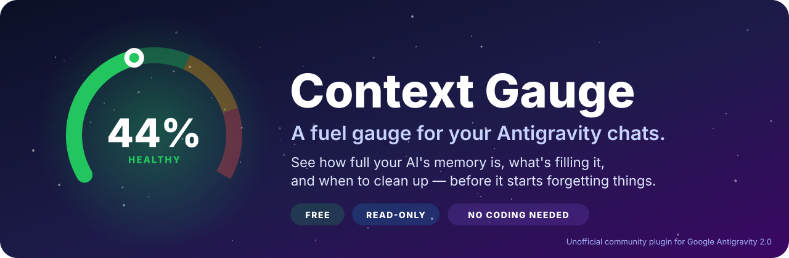
</p>

<p align="center">
  <a href="https://antigravity.google"></a>
  
  
  <a href="LICENSE"></a>
</p>

<p align="center">
  <b>Ever had the AI suddenly forget your naming rules, your scene setup, or what you asked for an hour ago?</b><br>
  Its memory filled up. <b>Context Gauge</b> shows you that memory, live, right inside Antigravity.
</p>

<p align="center">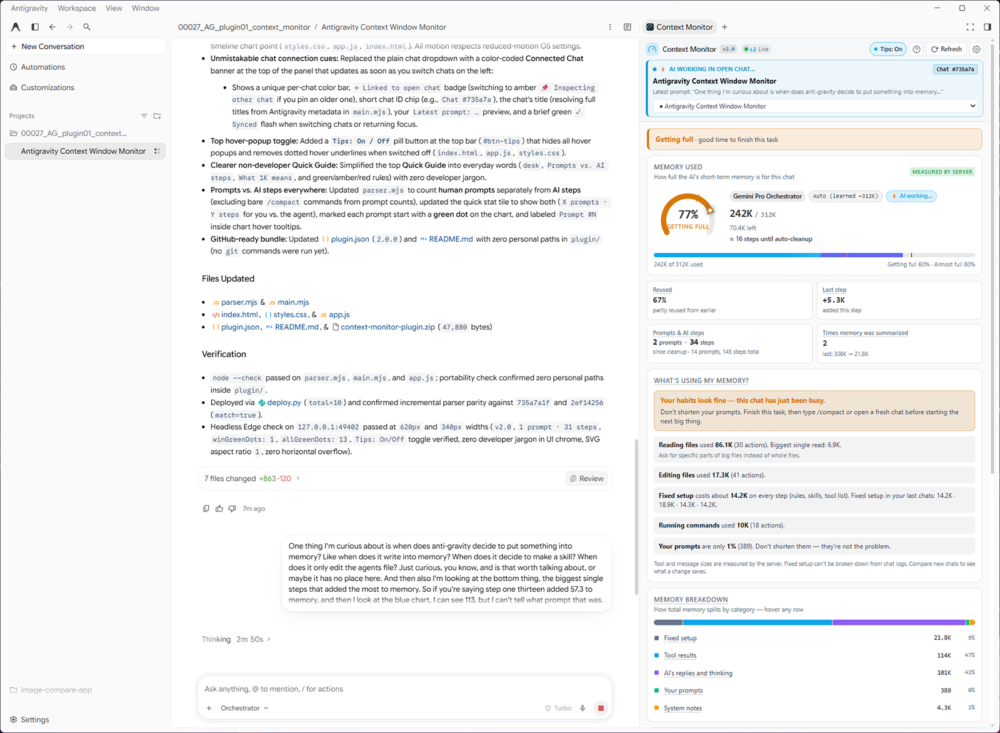</p>

<!-- GIF SLOT: docs/screenshots/live.gif — 10 seconds of the gauge ticking up while the agent works. Swap it in for hero.png above once you have it. -->

---

## ✨ What you get

| | |
|---|---|
| 🟢 **A gauge you can read at a glance** | Green, orange, red. Like a fuel gauge, except you want it low. |
| 🧩 **What's eating the space** | Files the AI opened? Its own long replies? Your Maya or Blender tools? Five colours tell you. |
| 🗣️ **Advice, not just numbers** | A "What's using my memory?" box tells you in plain words if you need to change anything. Usually: you don't. |
| 📈 **A timeline of your chat** | See which step made memory jump, and which of *your* prompts caused it. |
| 🧹 **A nudge before it's too late** | Counts down the steps until Antigravity cleans up by itself, with a one-click copy of `/compact`. |
| 💬 **Plain English everywhere** | Hover over anything for a friendly popup (turn them off with **Tips: Off**). No jargon degree required. |
| 🔒 **Hands off your stuff** | It only *reads*. Never changes your chats, never goes online. |

---

## 🧠 The 30-second explanation

<p align="center">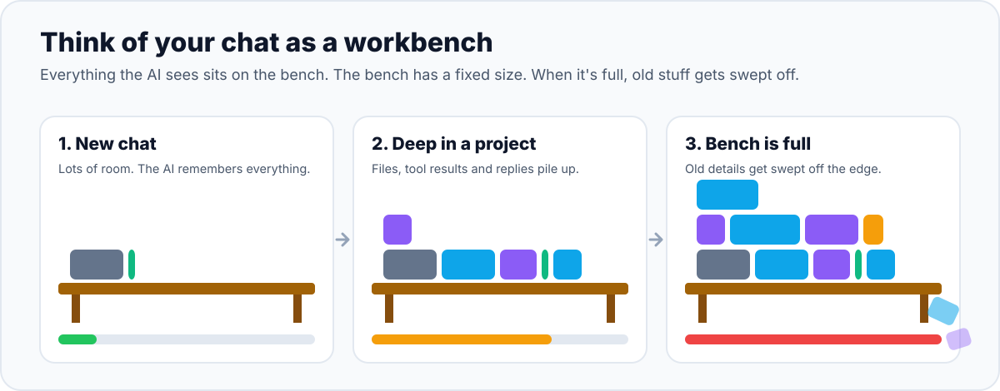</p>

Every AI chat has a **workbench** (techies call it the *context window*). Everything the AI needs to "see" has to fit on it: your messages, its replies, every file it opens, every result from Maya, Blender, Nuke or Photoshop.

The bench has a fixed size. When it's full, Antigravity **sweeps old stuff off the edge** to make room. That's when the AI starts "forgetting" things you told it earlier.

Context Gauge lets you **see the bench**, so you can tidy up on *your* terms.

---

## 🚀 Install

<p align="center">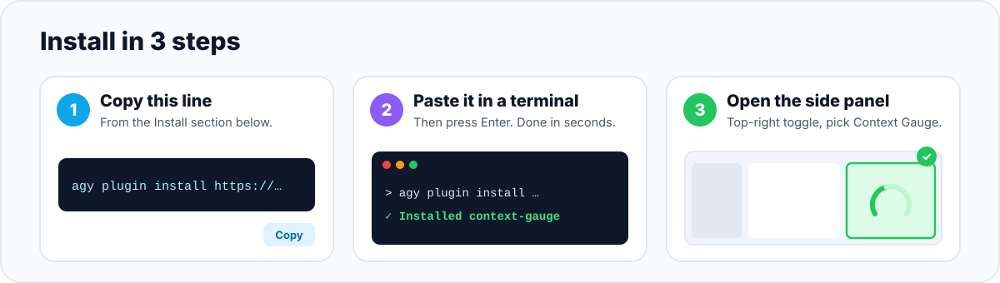</p>

**1. Copy this line:**

```
agy plugin install https://github.com/jontojek/context-gauge-for-antigravity
```

**2. Paste it into a terminal and press Enter.**
On Windows, press <kbd>Win</kbd>, type `cmd`, press <kbd>Enter</kbd>, then paste. On Mac, open **Terminal**.

**3. Open the panel.** In Antigravity, click the side-panel toggle in the top-right corner and pick **Context Gauge**. That's it! 🎉

<!-- GIF SLOT: docs/screenshots/install.gif — paste command, press Enter, open the panel. ~15 seconds. -->

<details>
<summary><b>Rather not use a terminal?</b></summary>

- **Ask Antigravity to do it.** In any chat, type: *"Install the plugin from https://github.com/jontojek/context-gauge-for-antigravity"*
- **Or copy it in by hand.** Click the green **Code** button above → **Download ZIP** → unzip it → copy the folder to:
  - Windows: `%USERPROFILE%\.gemini\config\plugins\context-gauge`
  - Mac / Linux: `~/.gemini/config/plugins/context-gauge`

</details>

<!-- When listed in the Antigravity Marketplace, add a big button here:
<a href="antigravity://plugin/context-gauge?marketplace=antigravity-plugins-partners"></a>
-->

---

## 🗺️ A quick tour

<p align="center">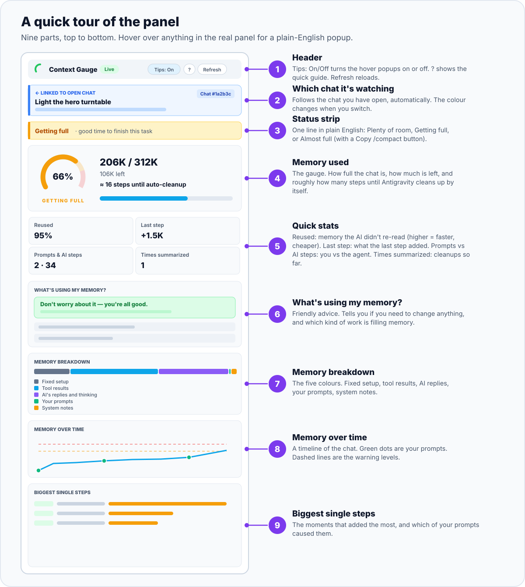</p>

And here's the real thing:

<p align="center">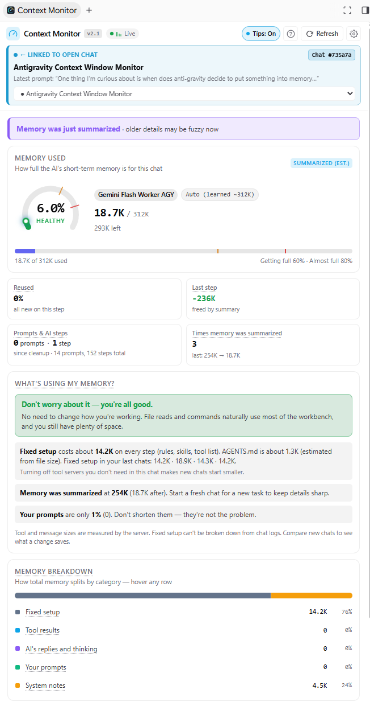</p>

> 💡 **Lost? Hover.** Every box, number and label has a plain-English popup. Click **?** in the panel header for a quick guide, or **Tips: Off** once you know your way around.

<p align="center">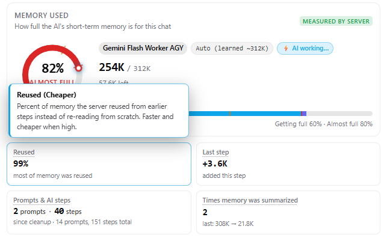</p>

---

## 🚦 Reading the gauge

<p align="center">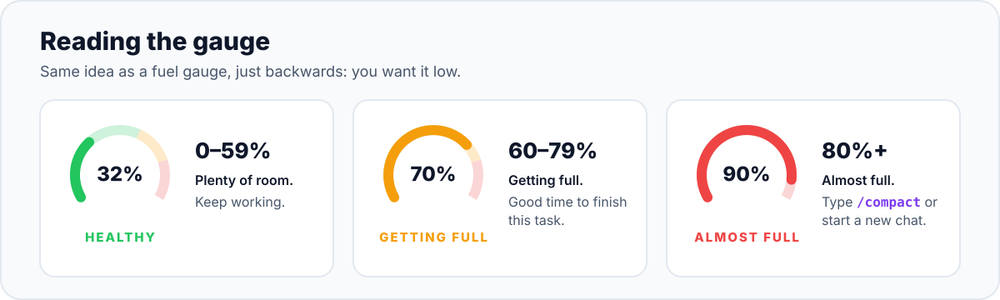</p>

<p align="center">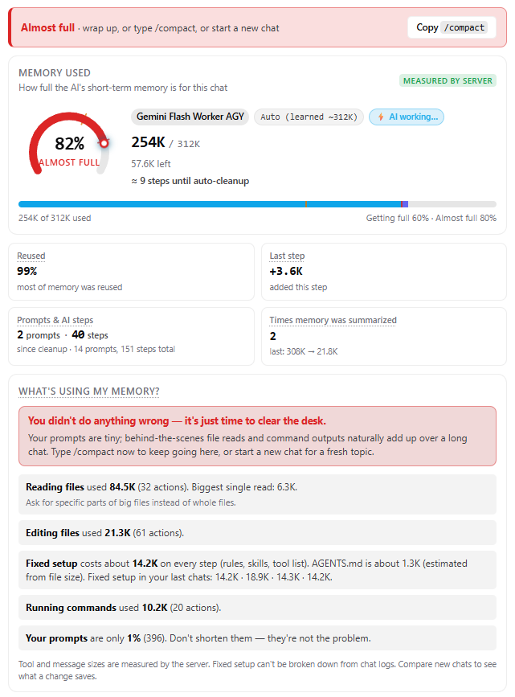</p>

---

## 🎨 What's using the memory?

<p align="center">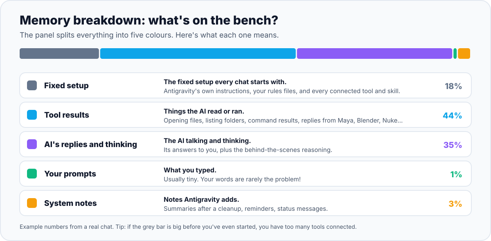</p>

**For DCC folks:** every app you connect (Maya, Blender, Nuke, Photoshop, Unreal…) adds its tool list to the grey **Fixed setup** slice, in *every* chat, before you've typed a word. And when the AI pulls a full scene graph or a long render log, that lands in blue **Tool results**. The **Biggest single steps** list shows exactly which step it was, and which of your prompts kicked it off:

<p align="center">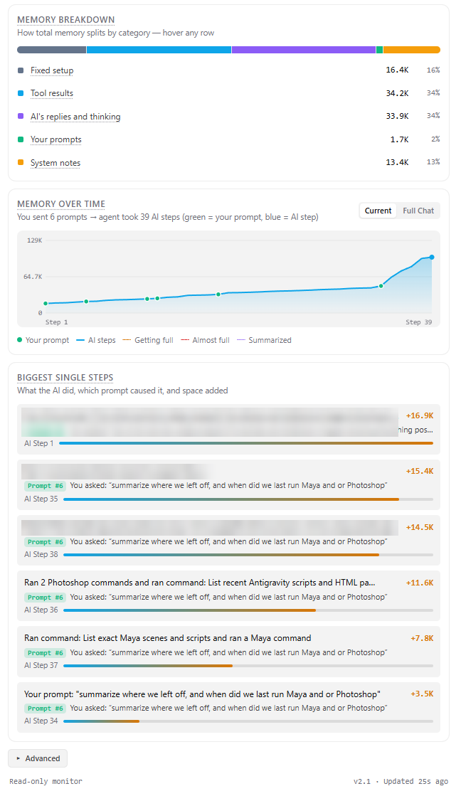</p>

---

## 🧹 Cleaning up with `/compact`

<p align="center">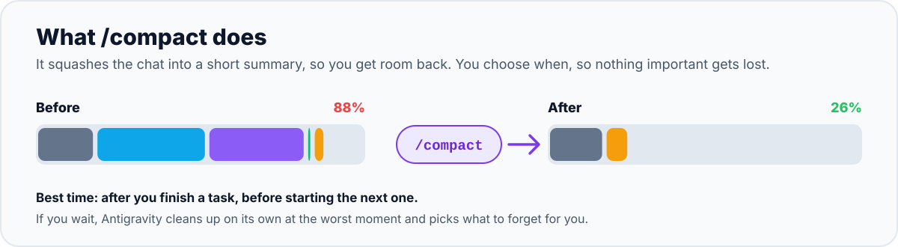</p>

Type `/compact` in the chat (or click **Copy /compact** in the panel's status strip when it turns red). Antigravity squashes the chat into a short summary and you get your bench back.

---

## 🏆 Pro tips

1. **One chat per job.** "Light the hero shot" and "fix the pipeline script" are two chats, not one.
2. **Compact at natural breaks.** Finished a shot, an asset or a step? Compact before the next one.
3. **Unplug what you're not using.** Not touching Nuke today? Turn its connection off and the grey slice shrinks in every chat.
4. **Ask for summaries, not dumps.** "Tell me which lights are in the scene" beats "print the whole scene".
5. **Check "Biggest single steps".** A big one usually means the AI opened a huge file or log. Next time, point it at the part you need.

---

## 📖 Jargon buster

| You'll hear | It means |
|---|---|
| **Context window** | The workbench. Everything the AI can see right now. |
| **Token** | The unit memory is measured in. About ¾ of a word. 100K tokens ≈ a 300-page book. |
| **Summarized / Auto-cleanup / Compaction** | Squashing the chat into a summary to free up room. You can trigger it with `/compact`, or Antigravity does it by itself when memory is almost full. |
| **Reused (cache)** | Bits the AI didn't have to re-read from scratch. Higher = faster and cheaper. |
| **Tool call** | The AI *doing* something: opening a file, running a command, talking to Maya. |

---

## ❓ FAQ

<details>
<summary><b>Do I need to know how to code?</b></summary>

Nope. Install it, open the panel, hover around. That's the whole learning curve.
</details>

<details>
<summary><b>Is my data safe? I work under NDA.</b></summary>

Yes. It only *reads* the chat logs Antigravity already keeps on your own computer. It never edits them, never uploads anything, and makes no internet connections at all. You can check: the code is all here and it's small.
</details>

<details>
<summary><b>Why does a brand-new chat already show 10–20% used?</b></summary>

That's the grey "Fixed setup" slice: Antigravity's own instructions, your rules files, and every tool and skill you have connected. More connections means less room for your actual work.
</details>

<details>
<summary><b>The panel is blank or won't open.</b></summary>

The plugin needs **Node.js**. Install the LTS version from [nodejs.org](https://nodejs.org), restart Antigravity, and try again. Still stuck? [Open an issue](../../issues).
</details>

<details>
<summary><b>Does it work on Mac and Linux?</b></summary>

It's built and tested on Windows, and should work on Mac and Linux too. If it doesn't, please [tell us](../../issues).
</details>

<details>
<summary><b>The memory size looks wrong for my model.</b></summary>

The panel learns the size from your chat automatically (it shows **Auto** next to the model name). If a new model shows the wrong size, [open an issue](../../issues) with the model name.
</details>

<details>
<summary><b>How do I update or remove it?</b></summary>

**Update:** run the install command again. An open panel refreshes by itself.
**Remove:** turn it off in Antigravity's Customizations, or delete the `context-gauge` folder from your plugins folder.
</details>

---

## 🌗 Looks at home in light and dark

<p align="center">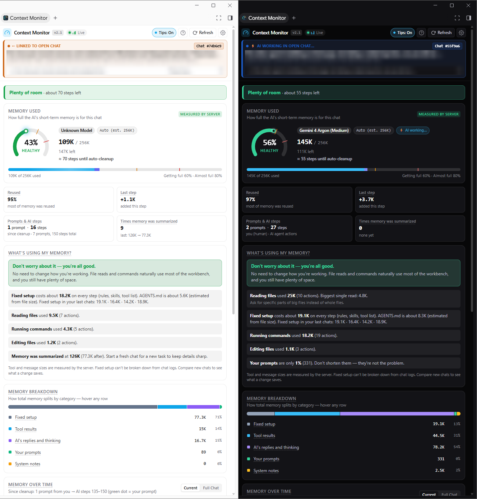</p>

---

## 💌 Feedback

Bug? Idea? Just want to say it helped? [Open an issue](../../issues). Screenshots help a lot (please hide anything private first).

## 📄 License

[MIT](LICENSE). Free to use, share and change.

<sub>Context Gauge is an unofficial community plugin. Antigravity is a trademark of Google LLC. This project is not made, endorsed or supported by Google.</sub>
